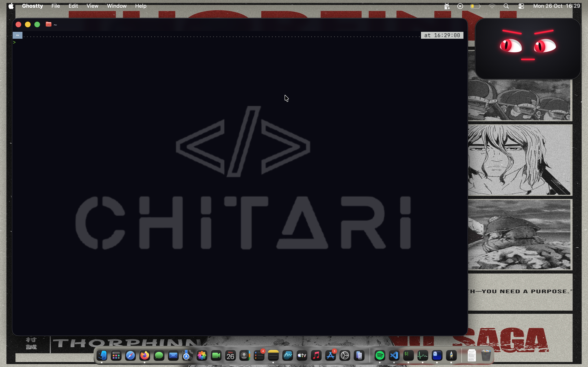

# 🤖 Manga AI Desktop Assistant

Un assistant virtuel IA en local, animé, vocal et interactif pour ton bureau. Il fonctionne avec **Ollama** (modèle `Qwen 2.5`), dispose d'une interface utilisateur flottante transparente au style Manga (yeux enflammés) et est capable d'exécuter des tâches directement sur ta machine (Tool Calling / Function Calling).

---

## 🌟 Fonctionnalités

- **🧠 Cerveau IA Local (Ollama)** : Intégration de `qwen2.5:1.5b` pour des réponses ultra-rapides et entièrement privées (aucun envoi de données vers le cloud).
- **👁️ Avatar Manga Animé** :
  - Design compact avec lueur néon et yeux rouges enflammés.
  - Fenêtre transparente et flottante en haut à droite de l'écran (`Always-on-Top`).
  - Animations synchronisées pour le clignement des yeux, la parole (`speaking`) et l'écoute (`listening`).
- **🎙️ Interaction Vocale** :
  - **Speech-to-Text (STT)** : Écoute du microphone et transcription automatique du français via `speech_recognition`.
  - **Text-to-Speech (TTS)** : Synthèse vocale optimisée et réactive avec voix française native via `pyttsx3`.
- **🛠️ Exécution de Tâches Système (Function Calling)** :
  - Lancement du navigateur par défaut.
  - Ouverture du terminal.
  - Consultation de l'heure système.
  - Inspection et listing des fichiers sur le bureau (`~/Desktop`).

---

## 🛠️ Architecture du Projet

```text
.
├── app.py          # Script principal (PyQt6, gestion Ollama, TTS, STT & Tools)
├── index.html      # Interface visuelle de l'avatar (HTML5/CSS33/JS)
├── requirements.txt # Dépendances Python
└── README.md       # Documentation du projet